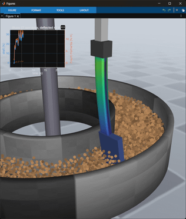
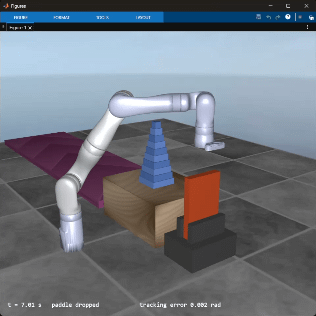
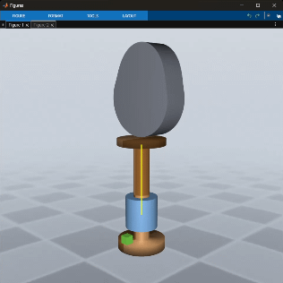
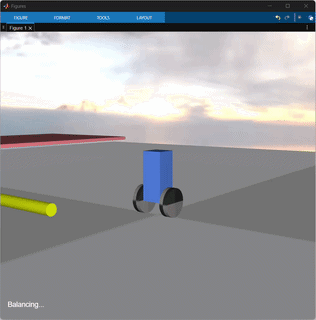
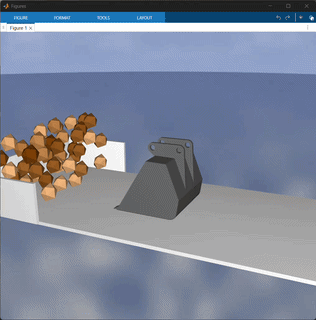
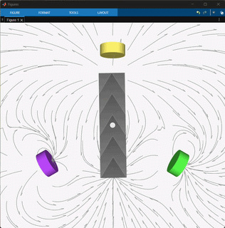
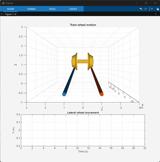
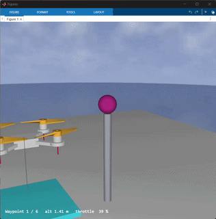
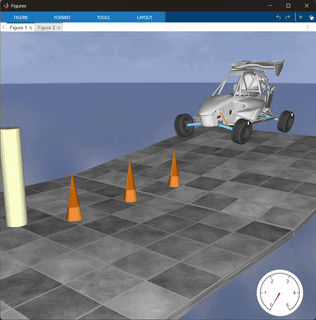

# PHX Toolbox

**Object-oriented MATLAB API and Simulink blocks for 3D physics of rigid and deformable bodies.**

PHX Toolbox allows you to build models from physical objects such as bodies with different
shapes, soft and flexible bodies, particles, joints, springs, ropes, force fields, sensors, or
custom elements. The model is drawn directly into MATLAB axes and can be simulated immediately
with one command. Simulation is powered by the
[Jolt Physics](https://github.com/jrouwe/JoltPhysics) engine, enhanced for engineering use
and for co-simulation with custom MATLAB elements.

[](https://matlab.mathworks.com/open/github/v1?repo=Humusoft/phx&project=PHXToolbox.prj&file=examples/phxex_buggy.m)

> ⚠️ **Technical preview.** PHX is published as a technical preview for evaluation
> and feedback. APIs may change between releases.

## 🚀 PHX 2.0 is here!

PHX 2.0 is the biggest update yet: a new physics engine, deformable bodies, and a big step
up in accuracy, stability and speed.

* **New physics engine** — Jolt Physics with modified and custom solvers, tuned for
engineering use
* **Soft and flexible bodies** — inflatable soft bodies, finite-element flexible solids meshed
from PHX shapes or PDE Toolbox meshes, and thousands of particles for granular materials
* **Accurate mechanisms** — the joints of a mechanism are solved together and directly, so
chains, robot arms and linkages hold at any mass ratio and report their true reactions
* **Stable contacts and springs** — stacks stay put, and stiff springs and ropes are solved
inside the engine
* **Faster on many cores** — multithreaded steps, typically 3–6× faster on scenes with
hundreds to thousands of bodies, with identical results on any number of threads
* **Know how accurate you are** — built-in diagnostics report solver convergence,
penetrations and joint gaps, and suggest a remedy when something is off
* **More to model with** — limits for more joint types, centres of mass from the shapes,
truncated cones, rolling resistance, body accelerations
* **8 new examples** — from an airbag and a plow in granular soil to a roller coaster and a
delta robot

Coming from PHX 1.x? The User Guide topic **Upgrading from PHX 1.x** lists every change, and
the `phx-upgrade-from-1x` skill lets your AI agent port a scene for you.

 


## Features

* Rigid-body dynamics with collisions, friction and rolling resistance — boxes, spheres,
cylinders, cones, capsules, tubes, extrusions, revolutions, rocks, terrain heightfields and
imported OBJ/STL/PLY meshes, each with its own centre of mass and inertia
* Deformable bodies — soft bodies made of triangle meshes, finite-element flexible solids
meshed from PHX shapes or PDE Toolbox meshes, rigid parts welded into them, and bulk
particles for granular materials
* Joints (revolute, prismatic, cylindrical, spherical, gear, fixed, bushing and a generic
6-DOF joint), most of them with limits, solved together and directly for accurate mechanisms
* Linear and torsion springs and ropes routed over pulleys, solved inside the engine
* Motorized joints — an angular or linear velocity target with a torque or force limit,
which doubles as a holding brake; persistent forces and torques on bodies and joints
* Force and field elements (thrusters, resistance, buoyancy, dipole/monopole fields)
* Prefab assemblies — arenas, jointed chains, scattered bodies, brick walls, URDF and
rigidBodyTree import
* Sensing and analysis — loggers, traces, measurements, detection zones, ray sensors
* Automation and control — timed scripts, per-step callbacks, closed-loop control from MATLAB
* Accuracy diagnostics that report solver convergence, penetrations and joint gaps
* Multithreaded engine steps with identical results on any number of threads
* Interactive viewer with textures, sky backgrounds, tracking cameras and projected shadows
* Simulink blocks for closed-loop co-simulation
* Headless stepping for batch runs, optimization and experiments

PHX Toolbox also includes a set of AI skills for use with common AI agents. They are
installed with the toolbox in its `skills` folder;
see **AI agent skills** in the User Guide for how to point your assistant at them.

 
 
 

## Requirements

* MATLAB **R2025a or newer**
* Simulink (only for the Simulink block)
* Windows, Linux or macOS on Apple Silicon

## Installation

Download the latest `PHXToolbox.mltbx` from the
[Releases](https://github.com/Humusoft/phx/releases) page and double-click it in MATLAB (or use the
Add-On Manager). MATLAB installs the toolbox and adds it to the path.

## Quick start

```matlab
clf; view(3); axis equal; grid on; camlight headlight;

phx.Body("Type", "static");            % ground
phx.Body("Position", [0.6 -0.5 2]);    % a body that will fall onto it

sim = phx.Simulation;
sim.step(1, 100, 1);                   % simulate 1 s in 100 substeps, redrawing
```

## Documentation

Once installed, the full documentation is in the MATLAB Help browser under
**Supplemental Software → PHX Toolbox**: a Getting Started topic, a User Guide covering
core concepts, units and engine settings, bodies and shapes, soft and flexible bodies,
joints, forces, assemblies, logging, automation, saving scenes, Simulink co-simulation, the
interactive viewer, the AI agent skills and upgrading from PHX 1.x, plus an illustrated
Examples gallery and the class reference. `phxdoc phx.Body` opens a single reference page
directly.

Over 60 ready-to-run examples are in the [`examples/`](https://github.com/Humusoft/phx/tree/2.0.0/examples) folder (all named
`phxex_*`) — each one is a single command in the Command Window. A guided introduction
is in [`doc/GettingStarted.mlx`](https://github.com/Humusoft/phx/blob/2.0.0/doc/GettingStarted.mlx).

## License

PHX is a source-available **technical preview**, licensed under the **PHX Preview
License** (see [`LICENSE.txt`](https://github.com/Humusoft/phx/blob/2.0.0/LICENSE.txt)). In short: you may read and adapt the
MATLAB (`.m`) source and use PHX for free, including commercially — but it is not
for sale and may not be used to build a competing product. The physics engine is
provided as a compiled binary.

PHX bundles the Jolt Physics engine under the MIT License, with portions derived from
Bullet Physics under the zlib License; see [`NOTICE.txt`](https://github.com/Humusoft/phx/blob/2.0.0/NOTICE.txt) for attribution.

A separate **commercial license** will be available from HUMUSOFT s.r.o. for uses the
Preview License does not permit. Contact us at phx@humusoft.cz.

## Contributing

During the technical preview we welcome bug reports and feedback via the issue
tracker, but we are not yet accepting external code contributions. See
[`CONTRIBUTING.md`](https://github.com/Humusoft/phx/blob/2.0.0/CONTRIBUTING.md).

## About

PHX is developed by [HUMUSOFT s.r.o.](https://www.humusoft.cz).

